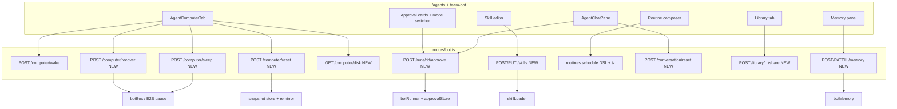

# Phase 2 plan: LoopGPT bot mode — Grok UX parity

Status: planning only (2026-10-20). **Do not implement Phase 2 until this plan is accepted.**  
Parent: `loopgpt_bot_mode_grok_parity_8d692984.plan.md` (Phase 2 bullet list).  
Prerequisite: Phase 1 verified — see [docs/validation/bot-parity-01.md](../validation/bot-parity-01.md).  
Out of scope: `.opencode/`, `.bots/`, `bot-console/`, Phase 3 (team publish, secrets/MCP, webhook/Slack/email triggers, credits billing, local-machine bridge).

---

## 1. Goal

Make LoopGPT’s product bot mode (`/agents`, team-bot UI, `botBox` / `botRunner`, desktop gateway) match **Grok Bot 0.71.2 core UX** that Phase 1 did not cover: computer Sleep/Recover/Reset + disk warning, teach naming/discard/learn-from-recording, skills editor + run-from-library, memory add + private/team, Grok-style routine schedules + timezone + away auto-pause, chat attachments + reset conversation + rich render, library of bot-made pages/files/apps with share links, and computer/terminal/tool approvals with an approval-mode switcher.

Phase 1 already made the core path work end to end. Phase 2 adds the missing product surfaces on top of those contracts.

---

## 2. Phase 1 contracts to reuse (do not reinvent)

| Contract | Where | Reuse in Phase 2 |
| --- | --- | --- |
| `POST /api/bot/computer/wake` + side-effect-free `GET /api/bot/computer` | [backend/src/routes/bot.ts](../../backend/src/routes/bot.ts), [packages/api-client/src/bot.ts](../../packages/api-client/src/bot.ts) `wakeBotComputer` / `getBotBox` | Sleep is the inverse of wake; Recover/Reset build on the same box row + stream URLs |
| `POST /api/bot/computer/ws-token` → `?token=` on websockify | [novncProxy.ts](../../backend/src/services/novncProxy.ts), `mintNovncWsToken`, [BotScreen.tsx](../../apps/web/app/components/team-bot/BotScreen.tsx) | All computer views keep minting tokens; Recover/Reset must re-mint after sandbox id change |
| Run event `skill_saved` `{ skillId, name? }` | [botRunner.ts](../../backend/src/services/botRunner.ts), [useTeachSession.ts](../../apps/web/app/components/team-bot/useTeachSession.ts) | Teach naming UI still waits on this event; Learn-from-recording should emit the same |
| Event cursor `GET …/runs/:runId/events?after=<seq>` | [botRuns.ts](../../backend/src/services/botRuns.ts), `streamBotRun` | Approval cards, attachment progress, and teach distill all stream on this feed |
| Pause-on-timeout + workspace mirror | [e2bDesktop.ts](../../backend/src/services/e2bDesktop.ts) `lifecycle.onTimeout: 'pause'`, [botBox.ts](../../backend/src/services/botBox.ts) `restoreWorkspaceIn` / `syncWorkspaceOut` | Sleep = explicit pause; Recover keeps mirror; Reset restores snapshot then mirror policy |
| Routines CRUD + pause/resume | [routines.ts](../../backend/src/services/routines.ts), `POST/PATCH/DELETE /api/bot/routines` | Extend schedule string + timezone fields; keep pause semantics |
| Skills list/delete (bot) + create/update (agent) | `GET/DELETE /api/bot/skills`, [skillLoader.ts](../../backend/src/agent/skills/skillLoader.ts) `createUserSkill` / `updateUserSkill`, [routes/agent.ts](../../backend/src/routes/agent.ts) skill CRUD | Bot routes should expose create/update (or thin proxy) for the `/agents` editor |
| Memory read + `remember_fact` | `GET /api/bot/memory?botId=`, [botMemory.ts](../../backend/src/services/botMemory.ts), [metaTools.ts](../../backend/src/agent/tools/metaTools.ts) | Add write/list/delete + visibility; keep prompt injection |
| Chat rich render (main chat, not bot yet) | [Markdown.tsx](../../apps/web/app/components/chat/Markdown.tsx) (md + KaTeX + mermaid fences), [ArtifactViewers.tsx](../../apps/web/app/components/chat/ArtifactViewers.tsx) (PDF/xlsx/mermaid) | Import into bot chat bubbles / library preview — do not fork viewers |
| Tool approval store (interactive chat) | [approvalStore.ts](../../backend/src/agent/approvalStore.ts), [TurnActivity.tsx](../../apps/web/app/components/chat/TurnActivity.tsx), [agentRuntime.ts](../../backend/src/agent/agentRuntime.ts) `permissionFor` | Port gate into `botRunner` + SSE events; reuse UI card patterns |

---

## 3. Architecture sketch (Phase 2 additions)

---

## 4. Area plans

### 4.1 Computer: Sleep / Wake, Recover, Reset, low-disk warning

#### Current LoopGPT state

- **Wake exists** (Phase 1B): `POST /api/bot/computer/wake` boots/resumes and meters VM minutes; `GET /api/bot/computer` is status-only. Client: `wakeBotComputer` / `getBotBox`. UI: [AgentComputerTab.tsx](../../apps/web/app/components/team-bot/AgentComputerTab.tsx) probes then wakes on expand; [BotFilesPanel.tsx](../../apps/web/app/components/team-bot/BotFilesPanel.tsx) “Wake computer” on `no_box`.
- **Implicit sleep only**: E2B `lifecycle.onTimeout: 'pause'` ([botBox.ts](../../backend/src/services/botBox.ts), [e2bDesktop.ts](../../backend/src/services/e2bDesktop.ts)). No user-facing Sleep button; no explicit `sandbox.pause()`.
- **No Recover / Reset**: Fresh create restores workspace mirror (`restoreWorkspaceIn`) but there is no “keep logins/files, new VM” vs “restore last snapshot” product action. No snapshot id on `BotBox`.
- **No disk telemetry**: No `df` probe, no warning banner.
- Status strip shows asleep/alive/resumed but no Sleep control ([AgentComputerTab.tsx](../../apps/web/app/components/team-bot/AgentComputerTab.tsx) ~191–209).

#### Grok target behavior

- **Sleep**: User puts the computer to sleep immediately (pause VM, stop metering interactive minutes, stream goes offline). Wake resumes with files + desktop session state preserved where the provider allows.
- **Recover computer**: Recreate/reconnect the desktop when it is wedged **without** wiping user files or browser logins/cookies (workspace + profile persistence survive).
- **Reset computer**: Roll back the VM to the **last known-good snapshot** (template baseline or last checkpoint). Destructive confirm. Files not in the durable mirror may be lost — copy Grok’s copy.
- **Low-disk warning**: When free space on `/` or `/workspace` drops below a threshold, show a persistent non-blocking banner with “Free up space” affordance (open Files tab).

#### Implementation steps

1. **Backend — Sleep**
   - Add `pauseUserBox(userId)` in [botBox.ts](../../backend/src/services/botBox.ts): connect if needed, call E2B pause (or `setTimeout(0)` + provider pause API — verify `@e2b/desktop` / Sandbox pause in current SDK), clear `liveBoxes` entry, leave `BotBox` row + streamAuthKey intact.
   - Route: `POST /api/bot/computer/sleep` → `{ alive: false, sandboxId, paused: true }`.
   - Metering: stop interactive settle in [botComputerMeter.ts](../../backend/src/services/botComputerMeter.ts) on sleep (final settle of elapsed minutes).
2. **Backend — Recover**
   - `POST /api/bot/computer/recover`:
     - Sync workspace out (`syncWorkspaceOut`).
     - Kill current sandbox (provider kill), keep `BotBox` metadata intent.
     - Create new sandbox with same template + `lifecycle.onTimeout: 'pause'`.
     - `restoreWorkspaceIn` + `seedBotHomes` / profile seed **without** wiping `/home/user` browser profile dirs if those are part of the durable mirror — extend [workspaceSync](../../backend/src/services/workspaceSync.ts) include list for `.config`, browser profiles as needed (document exactly which paths are “logins”).
     - Re-persist stream URLs / auth key; return same shape as wake.
3. **Backend — Reset**
   - Persist `lastSnapshotId` (or `baselineTemplate` + optional checkpoint id) on `BotBox` (Prisma migration).
   - On first healthy boot after Phase 2 deploy, record baseline snapshot (E2B snapshot API if available; else treat “template + empty workspace remirror from last sync before reset” as v1, with documented gap vs true FS snapshot).
   - `POST /api/bot/computer/reset { confirm: true }`: destroy sandbox, create from snapshot/template, **do not** restore pre-reset workspace (or restore only explicit “kept” paths — match Grok: last snapshot wins). Clear teach-session dirs.
4. **Backend — Disk**
   - `GET /api/bot/computer/disk` (requires alive or wake-on-demand flag `?wake=0` only when box connected): run `df -PB1 / /workspace`, return `{ rootFreeBytes, workspaceFreeBytes, warn: boolean }`. Threshold e.g. 1 GiB free or 90% used (env `BOT_DISK_WARN_BYTES`).
   - Optionally piggyback disk on `GET /computer` when alive to avoid an extra round-trip.
5. **API client**: `sleepBotComputer`, `recoverBotComputer`, `resetBotComputer`, `getBotComputerDisk` in [packages/api-client/src/bot.ts](../../packages/api-client/src/bot.ts); shared types in [packages/shared/src/bot.ts](../../packages/shared/src/bot.ts).
6. **UI** ([AgentComputerTab.tsx](../../apps/web/app/components/team-bot/AgentComputerTab.tsx), expanded header):
   - Controls: **Sleep** | **Wake** (existing) | overflow menu **Recover…** / **Reset…** with confirm dialogs.
   - Banner: low-disk from disk probe (poll every 60s while Computer tab visible; never keepalive-poll when tab hidden — Phase 1 rule).
   - After Recover/Reset: remint ws-token via existing `mintNovncWsToken` before reconnecting `BotScreen`.

#### API / schema

| Method | Path | Body / notes |
| --- | --- | --- |
| POST | `/api/bot/computer/sleep` | none |
| POST | `/api/bot/computer/recover` | optional `{ taskType }` |
| POST | `/api/bot/computer/reset` | `{ confirm: true }` |
| GET | `/api/bot/computer/disk` | when box asleep → `409 no_box` or `{ warn: false, asleep: true }` |

Prisma `BotBox`: add `lastSnapshotId String?`, `pausedAt DateTime?`, optionally `diskWarnedAt`.

#### UI surfaces

- Computer tab embedded + expanded dialog header.
- Files tab may show the same disk banner.
- No new top-level nav.

#### Acceptance criteria

- Sleep → `GET /computer` reports not alive; wake resumes without cold-boot file loss for mirrored paths.
- Recover after intentional “wedged” state yields a live stream; `/workspace` files and documented login paths survive.
- Reset requires confirm; post-reset desktop matches snapshot/baseline; user sees success/failure toast.
- Low-disk banner appears when threshold crossed and clears when free again.
- Wake/ws-token/skill_saved contracts unchanged.

#### Test plan

- Unit: `pauseUserBox` / recover / reset with fake Sandbox (extend [botBox.reaper.test.ts](../../backend/src/services/__tests__/botBox.reaper.test.ts) or new `botBox.lifecycle.test.ts`).
- Route tests: sleep/recover/reset auth + confirm guard.
- Frontend: AgentComputerTab control smoke (vitest + RTL).
- Live smoke (`bot-live-smoke.mjs`): optional stages sleep → wake → disk probe when `E2B_API_KEY` set.

---

### 4.2 Teach: name/describe via chat or UI; Discard; Learn-from-recording

#### Current LoopGPT state

- Teach flow works (Phase 1C/1E): `kind: 'teach'` enqueue → ready → takeover → record → distill → `create_skill` → **`skill_saved`**. Hook: [useTeachSession.ts](../../apps/web/app/components/team-bot/useTeachSession.ts). UI pill in [AgentComputerTab.tsx](../../apps/web/app/components/team-bot/AgentComputerTab.tsx) starts with a **hard-coded goal** string (“Watch the operator demonstrate…”).
- Cancel exists; **no Discard recording** that abandons distill without cancelling the whole machine confusingly; no post-hoc rename before save.
- No “Learn from recording” on an already-saved teach session under `/workspace/teach-sessions`.
- Chat cannot “name this skill Foo” mid-teach; distill prompt is fixed in [botRunner.ts](../../backend/src/services/botRunner.ts) `teachDistillPrompt`.

#### Grok target behavior

- Before or during teach, user **names and describes** the skill (modal or chat: “Call this ‘Invoice export’ — pulls CSV from Stripe”).
- **Discard**: throw away the recording and do not create a skill (frames deleted; run cancelled/failed cleanly).
- **Learn from recording**: pick a prior recording (or last discarded-not-applicable saved frames) and run distill without re-demoing.

#### Implementation steps

1. **Extend teach start API**
   - `enqueue` / `session.start({ goal, skillName?, skillDescription? })`.
   - Persist on `AgentTask` metadata or teach scratch: `teachMeta: { name, description }`.
   - Pass into `teachDistillPrompt` and into `create_skill` args (botRunner forces name/description when meta present).
2. **UI name/describe**
   - Teach pill → opens small sheet: Name, Description (when to use), then Start.
   - Chat path: if user sends while `phase === 'waiting'|'recording'`, treat as meta update (`PATCH /api/bot/runs/:runId/teach-meta`) instead of new ops task — or document that naming must be in the sheet (prefer sheet + optional chat command “name this …”).
3. **Discard**
   - `session.discard()` → cancel task + `POST /api/bot/runs/:runId/teach/discard` deletes `/workspace/teach-sessions/<id>` frames; emits run event `teach_discarded`; UI → idle with toast.
4. **Learn from recording**
   - List: `GET /api/bot/teach/recordings` (scan box or durable mirror under teach-sessions).
   - `POST /api/bot/tasks` with `kind: 'teach'` + `{ recordingId, skillName?, skillDescription? }` skipping phase-1 wait; botRunner jumps to distill with stored frames.
5. **Wire** [useTeachSession.ts](../../apps/web/app/components/team-bot/useTeachSession.ts): phases `naming` (optional), `discarding`; still succeed only on `skill_saved`.

#### API / schema

- Teach meta on task JSON or new columns.
- Events: `teach_discarded`, keep `skill_saved`.
- Shared: extend `EnqueueBotInput` with `teach?: { name?, description?, recordingId? }`.

#### UI surfaces

- Computer expanded Teach pill + naming sheet.
- Library / Computer: “Learn from recording…” list.
- Optional chat hint when teach active.

#### Acceptance criteria

- Named teach produces skill with that name/description and `skill_saved`.
- Discard leaves no new skill and frees recording storage.
- Learn-from-recording creates a skill without requiring Take over.
- Cancel vs Discard are distinct in copy and outcome.

#### Test plan

- Extend [useTeachSession.test.ts](../../apps/web/app/components/team-bot/__tests__/useTeachSession.test.ts): naming → skill_saved; discard; learn path.
- botRunner unit: distill uses teachMeta; discard skips create_skill.
- Integration optional for recording list with fake boxFiles.

---

### 4.3 Skills: Add skill editor (markdown + when-to-use); Run skill from library

#### Current LoopGPT state

- Bot API: `GET /api/bot/skills`, `DELETE /api/bot/skills/:id` only ([bot.ts](../../backend/src/routes/bot.ts)).
- Full CRUD already on **agent** routes: `POST/PUT /api/agent/skills`, source, versions ([routes/agent.ts](../../backend/src/routes/agent.ts) + [skillLoader.ts](../../backend/src/agent/skills/skillLoader.ts) — `SKILL.md` frontmatter `name`, `description`, `triggers`, body = instructions).
- Library tab on `/agents` lists skills + delete ([page.tsx](../../apps/web/app/agents/page.tsx) `SkillCard`); [SkillManager.tsx](../../apps/web/app/components/team-bot/SkillManager.tsx) has **Run** when `onQueue` provided — **not wired** on `/agents` SkillCard today.
- Enqueue supports `skillId` ([agentTasks.ts](../../backend/src/services/agentTasks.ts)); suggestedSkills on enqueue (Phase 1E).

#### Grok target behavior

- **Add new skill**: editor with markdown body + “when to use” (description/triggers).
- **Run skill**: one click from library queues an ops task with that skill attached (computer on by default for computer skills).

#### Implementation steps

1. **Expose bot-scoped skill write** (prefer `/api/bot/skills` for one auth story on `/agents`):
   - `POST /api/bot/skills` → `createUserSkill` + enable + optional `botId`.
   - `PUT /api/bot/skills/:id` → `updateUserSkill`.
   - `GET /api/bot/skills/:id` → include `source` / `instructions` for editor.
   - Reuse validation from agent routes; do not delete agent routes (Settings may keep them).
2. **api-client**: `createBotSkill`, `updateBotSkill`, `getBotSkill`.
3. **UI — SkillEditor**
   - New component `apps/web/app/components/team-bot/SkillEditor.tsx`: fields Name, When to use (description + triggers chips), Markdown instructions (textarea or existing md editor if any), Save / Cancel.
   - Library tab: “Add skill” opens editor; SkillCard click → edit; keep Delete.
4. **Run skill**
   - SkillCard + SkillManager: `onQueue` → `enqueueBotTask({ goal: skill.description || skill.name, skillId: skill.id, computer: { enabled: true }, botId })`.
   - Confirm toast + open run / Computer as today for chat sends.

#### API / schema

- Mirror agent skill JSON; add `botId` on create when scoped.
- No Prisma change (skills remain filesystem under `AGENT_DATA_DIR`).

#### UI surfaces

- `/agents` Library tab (primary).
- Optional deep link `?tab=library&skillId=`.

#### Acceptance criteria

- Create/edit/delete skill round-trips; triggers match enqueue suggestions.
- Run skill enqueues with `skillId` and appears in chat thread.
- Taught skills remain editable in the same editor.

#### Test plan

- API tests for POST/PUT bot skills ownership.
- RTL: SkillEditor save calls API; Run button enqueues with skillId.
- Reuse skillLoader ownership tests patterns.

---

### 4.4 Memory: Add memories; private vs team

#### Current LoopGPT state

- Per-bot markdown mirror: [botMemory.ts](../../backend/src/services/botMemory.ts) (`BOT_MEMORY_CAP_CHARS` 1600), `GET /api/bot/memory?botId=` only.
- Agent writes via `remember_fact` ([metaTools.ts](../../backend/src/agent/tools/metaTools.ts)) → `appendBotMemory`.
- Details tab **read-only** display ([page.tsx](../../apps/web/app/agents/page.tsx)).
- No structured entries, no delete, no visibility (private vs team). Phase 3 owns Team Bots; Phase 2 should still introduce the **visibility field** and private default so Phase 3 can share team memories without a rewrite.

#### Grok target behavior

- User can **Add memory** (one-line note) from UI.
- Memories are **Private** (this bot / this user only) or **Team** (visible to teammates when team bots exist). Until Phase 3 teams ship, Team = stored + UI labeled but only owner reads (feature-flagged).

#### Implementation steps

1. **Evolve storage**
   - Option A (minimal): keep `.md` mirror; prefix lines `- [date] [private|team] text`.
   - Option B (preferred): JSONL or Prisma `BotMemory` table `{ id, ownerId, botId, visibility, content, createdAt }` + keep md export for box `MEMORY.md` seed.
2. **API**
   - `GET /api/bot/memory?botId=` → `{ memories: [{ id, content, visibility, createdAt }] }` (compat: also `memory` joined string for old UI).
   - `POST /api/bot/memory` `{ botId, content, visibility?: 'private'|'team' }`.
   - `DELETE /api/bot/memory/:id`.
   - Update `remember_fact` to set `visibility: 'private'` by default; optional arg later.
3. **Prompt injection**: `botMemoryPromptSection` lists private always; team only when caller is team context (Phase 3 hook — for now inject private only unless `LOOP_TEAM_MEMORY=1` and membership check stub).
4. **UI**: Details → Memory section: list, Add form, visibility toggle, delete. Empty state CTA.

#### API / schema

- Prisma model recommended for delete-by-id and team queries.
- Shared types: `BotMemoryEntry`.

#### UI surfaces

- `/agents` Details tab.
- Optional chat slash `/remember …` → POST memory (nice-to-have).

#### Acceptance criteria

- Add/list/delete works; cap still enforced.
- Private memories never appear on another user’s GET.
- Team visibility persisted; cross-user read returns 403 until Phase 3 membership exists.
- Runs still receive memory via `remember_fact` / prompt section.

#### Test plan

- Extend [botMemory.test.ts](../../backend/src/services/__tests__/botMemory.test.ts).
- Route ownership tests.
- RTL memory panel.

---

### 4.5 Routines: Grok schedule options + timezone + auto-pause while away

#### Current LoopGPT state

- Schedule DSL: `^\d+[mhd]$` only ([agentTasks.ts](../../backend/src/services/agentTasks.ts) `SCHEDULE_RE` / `parseScheduleMs`).
- UI composer: goal + free-text schedule + skill select ([page.tsx](../../apps/web/app/agents/page.tsx) `RoutineComposer`).
- Pause/resume/delete fixed in Phase 1C ([routines.ts](../../backend/src/services/routines.ts), integration tests).
- No timezone; next run uses server/DB clock.
- No “away” detection or auto-pause.

#### Grok target behavior

- Schedule presets: every hour / every day at T / weekday at T / weekly on D at T / custom.
- User **timezone** (IANA) stored on routine (or user prefs).
- **Auto-pause while away**: when user has been inactive on bot surfaces for N days (or explicit “I’m away”), pause routines; on return show resume prompt.

#### Implementation steps

1. **Schedule DSL v2** (store opaque string + normalized cron or JSON):
   - Examples: `hourly`, `daily@09:30`, `weekdays@09:30`, `weekly:mon@09:30`, keep legacy `6h` / `1d`.
   - Implement `parseScheduleNext(schedule, timeZone, fromDate): Date` in new `backend/src/services/routineSchedule.ts` (use `Intl` or `luxon` if already a dep — prefer no new dep).
   - Replace interval-only requeue in [agentTasks.ts](../../backend/src/services/agentTasks.ts) complete path for `kind === 'scheduled'`.
2. **Schema**: `AgentTask.schedule` stays string; add `timezone String?` (default user pref or `UTC`). User pref: `User.botTimezone` or localStorage + POST on create.
3. **API**: extend `POST /routines` body `{ schedule, timezone?, autoPauseWhenAway?: boolean }`; validate via new parser.
4. **Away**
   - Track `User.lastBotActiveAt` updated by bot route middleware / wake / enqueue.
   - Cron or worker tick: if `now - lastBotActiveAt > AWAY_MS` (e.g. 7d) and routine.autoPauseWhenAway, call `setRoutinePaused(..., true)` with reason `away`.
   - UI: banner “Routines were paused while you were away” + Resume all / Keep paused.
5. **UI**: replace free-text schedule with preset select + time picker + timezone select; show next run in that zone.

#### API / schema

- `timezone`, `autoPauseWhenAway`, `pausedReason?: 'user'|'away'|null` on routine DTO.
- Shared `BotRoutine` update in api-client.

#### UI surfaces

- Details tab RoutineComposer / RoutineCard.
- Global away banner on `/agents`.

#### Acceptance criteria

- Each preset fires nextAttemptAt correctly across DST for a named zone (test fixtures).
- Legacy `30m`/`6h`/`1d` still work.
- Away auto-pause pauses eligible routines once; resume prompt clears reason.
- Phase 1 pause-during-run stickiness unchanged.

#### Test plan

- Unit matrix for `parseScheduleNext` (hour/day/weekday/weekly/custom + legacy).
- Integration: scheduled requeue uses timezone.
- RTL: composer emits DSL string.

---

### 4.6 Chat: attachments, Reset conversation, rich render

#### Current LoopGPT state

- [AgentChatPane.tsx](../../apps/web/app/components/team-bot/AgentChatPane.tsx): text-only composer; thread = AgentTasks list; no attachments; no reset; bot bubbles are plain text / status chips (not Markdown).
- Main product chat already has attachments ([Composer](../../apps/web/app/components/chat/Composer.tsx), upload hooks), Markdown+KaTeX+mermaid ([Markdown.tsx](../../apps/web/app/components/chat/Markdown.tsx)), PDF/xlsx viewers ([ArtifactViewers.tsx](../../apps/web/app/components/chat/ArtifactViewers.tsx)). **Reuse, don’t rewrite.**
- Bot runs can emit `artifact` events ([LineRender.tsx](../../apps/web/app/components/team-bot/LineRender.tsx)); chat pane does not render them richly.

#### Grok target behavior

- **Drop a file** on the bot chat; file is available to the run (workspace upload and/or attachment ids in goal context).
- **Reset this conversation**: clears the visible thread / task history for the bot chat **without** deleting memory, skills, routines, files, or computer state.
- Rich render in bot replies: markdown, mermaid fences, KaTeX, and inline/open for PDF / xlsx / docx artifacts.

#### Implementation steps

1. **Attachments**
   - Reuse upload endpoint from main chat if owner-scoped; or `POST /api/bot/attachments` → write into box `/workspace/inbox/<name>` via [boxFiles.ts](../../backend/src/services/boxFiles.ts) (wake if needed).
   - Enqueue body: `attachmentPaths?: string[]` or `attachmentIds?: string[]`; botRunner prepends “Attached files: …” to the user message / system note.
   - UI: drag-drop zone on AgentChatPane + paperclip (pattern from chat Composer).
2. **Reset conversation**
   - `POST /api/bot/conversation/reset { botId? }`: soft-hide or archive tasks for thread display (`AgentTask.hiddenFromChatAt` or separate `BotChatCursor` watermark). **Do not** cancel routines or delete skills/memory/files.
   - Client: clear local thread state; listBotTasks filters `hiddenFromChatAt IS NULL` or `createdAt > cursor`.
3. **Rich render**
   - Bot bubble for `result` / final content: render via shared `Markdown`.
   - Artifact chips open panel reusing ArtifactViewers; add docx viewer if missing (mammoth or download-only v1 — if download-only, document gap).
   - Mermaid/KaTeX covered by Markdown; PDF/xlsx by ArtifactViewers.

#### API / schema

- `EnqueueBotInput.attachments?: { path: string; name: string }[]`
- `BotChatCursor` or `hiddenFromChatAt` on tasks.
- `POST /api/bot/conversation/reset`

#### UI surfaces

- AgentChatPane header menu: “Reset conversation”.
- Composer drop target.
- Bubble markdown + artifact strip.

#### Acceptance criteria

- Dropped file appears on box and is referenced in the run.
- Reset clears thread UI; memory/skills/routines/files unchanged; computer still wakeable.
- Sample md/math/mermaid/pdf/xlsx render in bot thread without console errors.
- Composer still gated on `computerAllowed` / `computerConfigured` (Phase 1E).

#### Test plan

- RTL: reset watermark; attachment chip; Markdown in bubble (reuse Markdown.math tests pattern).
- API: reset does not delete BotMemory / skills / routines.
- boxFiles write to inbox path jail tests.

---

### 4.7 Library: pages / files / apps the bot made + share-page links

#### Current LoopGPT state

- Library tab = **skills only** ([page.tsx](../../apps/web/app/agents/page.tsx)).
- Files live under Computer → [BotFilesPanel.tsx](../../apps/web/app/components/team-bot/BotFilesPanel.tsx) (`/workspace`).
- Run artifacts exist on BotRun but are not catalogued into a durable “library”.
- No share-page links for bot-made HTML/apps.

#### Grok target behavior

- Library shows **pages, files, and apps** the bot created (plus skills section).
- **Share page**: generate a link others can open (time-limited or published).

#### Implementation steps

1. **Catalog**
   - On artifact create / `create_document` / notable writes under `/workspace/exports` or `/workspace/sites`, upsert `BotLibraryItem { id, userId, botId, kind: 'page'|'file'|'app'|'skill', name, path, mime, createdAt, shareId? }`.
   - Skills already listed — unify under Library with subtabs: Skills | Pages | Files | Apps.
2. **API**
   - `GET /api/bot/library?botId=&kind=`
   - `POST /api/bot/library/:id/share` → `{ url, expiresAt }` signed URL (pattern: Loop-IT preview tokens or existing file share if any).
   - `GET /api/bot/share/:token` public read (auth optional) serving HTML/file with tight CSP.
3. **UI**
   - Library tab redesign: subtabs + cards; Pages open preview; Share copies link; Files deep-link to BotFilesPanel path.
4. **Convention**: document where the agent should write publishable pages (`/workspace/sites/<slug>/index.html`) in bot system prompt ([botRunner.ts](../../backend/src/services/botRunner.ts) `BOT_SYSTEM_PROMPT`).

#### API / schema

- Prisma `BotLibraryItem` + `BotShareToken`.
- Shared types for library DTOs.

#### UI surfaces

- `/agents` Library tab (expand beyond skills).
- Optional share landing route `apps/web/app/share/[token]/page.tsx` or API-only content URL.

#### Acceptance criteria

- Artifacts from a run appear in Library without manual import.
- Share link opens read-only page for anonymous viewer until expiry.
- Revoke share (DELETE) works.
- Skills subtab retains Add / Run / Delete from §4.3.

#### Test plan

- Unit: catalog upsert + share mint/verify.
- RTL: subtabs + copy link.
- Security: share token cannot escape `/workspace` jail (realpath, same as boxFiles).

---

### 4.8 Approvals: computer / terminal / tool approve + approval-mode switcher

#### Current LoopGPT state

- Interactive chat: `needsApproval`, [approvalStore.ts](../../backend/src/agent/approvalStore.ts), [TurnActivity](../../apps/web/app/components/chat/TurnActivity.tsx), modes via slash “Accept edits” ([SlashPalette.tsx](../../apps/web/app/components/chat/composer/SlashPalette.tsx)), [agentRuntime.ts](../../backend/src/agent/agentRuntime.ts) `permissionFor`.
- **botRunner does not pause for approvals** — tools run with granted list only ([botRunner.ts](../../backend/src/services/botRunner.ts)); no SSE `approval_required` event; no mode switcher on `/agents`.

#### Grok target behavior

- Dangerous computer actions, terminal commands, and sensitive tools **request approval** in the bot chat.
- User can switch **approval mode**: e.g. Ask always / Auto-approve safe / Accept all (names aligned with Grok; map to existing permission config).

#### Implementation steps

1. **Runner integration**
   - In botRunner tool loop (same path as agentRuntime permission check), when permission === `approval`:
     - Emit run event `{ type: 'approval_required', approvalId, name, args, category: 'computer'|'terminal'|'tool' }`.
     - `storeApproval(...)` keyed by bot run / synthetic conversation id `bot-run:${runId}`.
     - Wait until resolved or timeout (fail tool).
   - Resolve: `POST /api/bot/runs/:runId/approve { approvalId, approved: boolean }`.
2. **Categories**
   - Mark computer-use tools / shell / `create_custom_tool` with categories; map defaults in permission config.
3. **Approval mode**
   - Persist per user (or per bot): `botApprovalMode: 'ask' | 'safe' | 'accept'` in configStore or User prefs.
   - `GET/PUT /api/bot/settings/approvals`.
   - Switcher in AgentChatPane header or Details.
4. **UI**
   - Reuse TurnActivity-style card inside AgentChatPane / RunViewer for live approvals.
   - Mode switcher copy: Ask / Auto (safe) / Accept all — document mapping to `permissionFor`.

#### API / schema

- Events: `approval_required`, `approval_resolved`.
- Routes: approve + settings.
- Shared `BotEvent` types extended.

#### UI surfaces

- Chat pane + optional RunViewer.
- Settings / Details mode switcher.

#### Acceptance criteria

- In Ask mode, a terminal/computer tool blocks until Approve/Deny; deny skips tool with error content; run can continue or stop per policy.
- Accept all does not show cards (except hard-required tools like credential-bearing create_custom_tool — keep agentRuntime invariant).
- Mode persists across reloads.
- Stream reconnect (`?after=`) still delivers pending approval if unresolved.

#### Test plan

- botRunner unit with fake tool needing approval + resolve.
- Frontend: card Approve calls API; mode switch hides cards.
- Regression: teach `create_skill` / `skill_saved` still works (create_skill should stay auto-allowed during teach).

---

## 5. Sequenced workstreams (dependencies)

Implement in this order unless noted parallel-safe.

| # | Workstream | Depends on | Delivers |
| --- | --- | --- | --- |
| **WS0** | Shared types + api-client stubs + validation doc stub `docs/validation/bot-parity-02.md` | Phase 1 | Contracts frozen for UI/backend parallel work |
| **WS1** | Computer Sleep / Recover / Reset / disk | WS0; Phase 1 wake/ws-token/mirror | Computer overflow controls + banner |
| **WS2** | Approvals + mode switcher in botRunner + chat cards | WS0; Phase 1 event seq | Safe default for later computer-heavy UX |
| **WS3** | Teach naming / Discard / Learn-from-recording | WS0; Phase 1 `skill_saved` | Teach parity |
| **WS4** | Skills editor + Run from library | WS0; skillLoader / agent skill CRUD | Library skills complete |
| **WS5** | Memory add + private/team | WS0; botMemory | Details memory CRUD |
| **WS6** | Routine schedule DSL + timezone + away auto-pause | WS0; Phase 1 routine pause | Grok schedules |
| **WS7** | Chat attachments + reset conversation + rich render | WS0; preferably WS2 for attachment-triggered tools | Chat UX parity |
| **WS8** | Library catalog + share links | WS7 artifacts helpful; WS4 for skills subtab | Full Library tab |

**Parallelism:** WS3/WS4/WS5 can proceed in parallel after WS0. WS1 and WS2 in parallel after WS0. WS6 independent after WS0. WS7 after WS0 (WS2 soft-dep). WS8 last.

**Suggested milestone cuts**

1. **M2a** — WS0+WS1+WS2 (computer controls + approvals).  
2. **M2b** — WS3+WS4+WS5 (teach/skills/memory).  
3. **M2c** — WS6+WS7+WS8 (routines/chat/library).

---

## 6. Cross-cutting constraints

- Preserve Phase 1 invariants: GET computer no side effects; no Computer-tab keepalive poll; view-only noVNC unless takeover; `skill_saved` for teach success; event `after=` cursor.
- Owner-scope every new route (`userId` from session); share links are the only intentional public surface.
- Metering: Sleep stops interactive minutes; Recover/Reset/Wake still subject to quota (`402`/`BOT_COMPUTER_*` permanent failures).
- Desktop app: any new computer routes must work through [gateway.cjs](../../apps/desktop/electron-main/gateway.cjs) proxy; ws-token remains required for RFB.
- Do not implement Phase 3 team invite/publish; only leave visibility/share hooks as specified.
- No commits from this planning doc alone.

---

## 7. Validation (when implementing)

Create `docs/validation/bot-parity-02.md` mirroring Phase 1’s area matrix:

- Unit/integration columns per workstream.
- Live E2B stages: sleep/wake, recover file survival, reset baseline, teach name→skill_saved, share link fetch.
- Frontend vitest for teach/approvals/composer/library.
- Extend `backend/scripts/bot-live-smoke.mjs` with gated optional stages (skip when no key).

---

## 8. File touch map (quick index for implementers)

| Area | Primary files |
| --- | --- |
| Computer | `backend/src/services/botBox.ts`, `e2bDesktop.ts`, `workspaceSync.ts`, `botComputerMeter.ts`, `routes/bot.ts`, `AgentComputerTab.tsx`, `packages/api-client/src/bot.ts` |
| Teach | `botRunner.ts`, `useTeachSession.ts`, `AgentComputerTab.tsx`, `agentTasks.ts` enqueue schema |
| Skills | `routes/bot.ts`, `skillLoader.ts`, `SkillEditor.tsx` (new), `agents/page.tsx`, `SkillManager.tsx` |
| Memory | `botMemory.ts`, `routes/bot.ts`, `metaTools.ts` `remember_fact`, `agents/page.tsx` |
| Routines | `routineSchedule.ts` (new), `agentTasks.ts`, `routines.ts`, `agents/page.tsx` RoutineComposer |
| Chat | `AgentChatPane.tsx`, `Markdown.tsx` / `ArtifactViewers.tsx` (import), `routes/bot.ts` reset/attachments, `botRunner.ts` |
| Library | new service + Prisma models, `agents/page.tsx` Library tab, share route |
| Approvals | `botRunner.ts`, `approvalStore.ts`, `routes/bot.ts`, `AgentChatPane.tsx`, configStore / settings |

---

## 9. Open decisions (resolve during WS0)

1. **Reset snapshot**: true E2B snapshot vs template+wipe workspace (affects Recover/Reset copy and tests).
2. **Team memory**: store-only vs hard-hide until Phase 3 (recommend store + owner-only read).
3. **Docx**: in-browser preview vs download-only for v1.
4. **Away threshold**: 3 vs 7 days; whether desktop heartbeat counts as activity.
5. **Approval category list**: exact tool names treated as computer vs terminal vs tool.

Record decisions in `bot-parity-02.md` when implementation starts.
